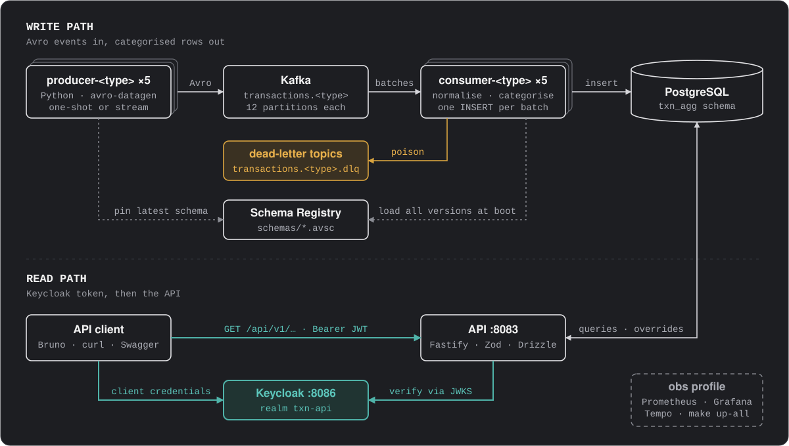
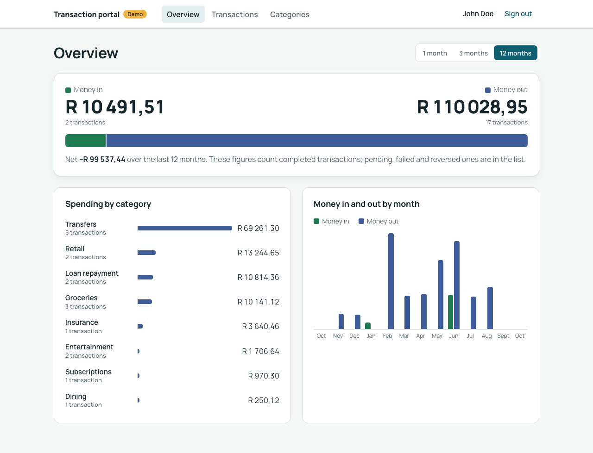

# transaction-aggregator

<!-- Platform -->


<!-- Apps -->


<!-- Observability -->


<!-- Testing and tooling -->


Transactions from five banking source systems (card, EFT, loan, debit order and internal transfer) arrive on Kafka as Avro records. One consumer per source categorises each transaction and stores it in PostgreSQL. A REST API, secured with Keycloak, serves each user's transactions, categories and spending summary, and lets them re-categorise a transaction or a whole category.

Synthetic data generators stand in for the source systems, so the whole system runs locally on Docker Compose. A small demo banking portal shows the API at work.

## How it fits together

<p align="center">
  
</p>

## Components

| Component | Where | What it does |
| --- | --- | --- |
| Producers | [apps/producers](apps/producers) | Python. Five containers, one per transaction type, generate records from `schemas/*.avsc` with avro-datagen and publish them as Avro to `transactions.<type>`. They send 18 months of history and exit, or stream live traffic. |
| Kafka | [infrastructure/kafka](infrastructure/kafka) | One KRaft broker with SASL/SCRAM. The `kafka-init` one-shot creates the users, the ACLs and the topics: `transactions.<type>` (12 partitions) and `transactions.<type>.dlq`. |
| Schema Registry | [infrastructure/schema-registry](infrastructure/schema-registry), [schemas](schemas) | Holds the Avro contracts. The `schemas-register` one-shot registers `schemas/*.avsc` before any producer starts. |
| Consumers | [apps/consumer](apps/consumer) | Node and TypeScript. One image runs as five containers, one per topic. Each batches records, normalises and categorises them, inserts the batch in one statement, and dead-letters records it can't store. See its [README](apps/consumer/README.md). |
| PostgreSQL | [database](database), [infrastructure/postgres](infrastructure/postgres) | Postgres 18 with pg_partman and pg_cron. The `migrate` one-shot applies the drizzle-kit migrations: the `txn_agg` schema with monthly partitions, the category and rule seed, the maintenance jobs and the Grafana views. |
| API | [apps/api](apps/api) | Node and TypeScript on Fastify. Lists a user's transactions, categories and spending summary, and stores their category overrides. Every `/api/v1` route needs a Keycloak bearer token. |
| Portal (demo) | [apps/portal](apps/portal) | A demo banking portal in Next.js, built to showcase the backend. A customer signs in through Keycloak; its server side is a BFF that calls the API as `banking-portal`, so the browser never holds a token the API accepts. Shows categories, spending by category and month, a cursor-paged transaction list, and re-categorising. See its [README](apps/portal/README.md). |
| Keycloak | [infrastructure/keycloak](infrastructure/keycloak) | Identity provider. The `txn-api` realm issues client-credentials tokens for the API and signs people in to kafbat-ui and the portal. |
| Observability | [infrastructure/observability](infrastructure/observability) | The `obs` profile (`make up-all`). Prometheus scrapes the API, the consumers and postgres-exporter; Grafana has four dashboards; the OpenTelemetry collector sends traces to Tempo. |
| Dev UIs | [infrastructure/kafbat](infrastructure/kafbat), [infrastructure/avro-datagen-ui](infrastructure/avro-datagen-ui) | The `ui` profile, on by default, with the portal. kafbat-ui browses topics and messages; avro-datagen-ui previews sample records for a schema. |
| API client | [api-client](api-client) | A Bruno collection: token requests, every API route and Schema Registry lookups. |

## Service targets

Built for the brief's shape: 2M users at 5 transactions a day ≈ 10M a day (~115/s sustained, ~1,200/s peak), kept for 18 months. The local stack proves that shape at smaller numbers.

| Target | Goal | Where to watch it |
| --- | --- | --- |
| API latency (list, detail, summary) | p95 < 200 ms at 50 RPS on a ≥5M-row database | Grafana → API, 200 ms threshold line |
| Ingest lag (insert time − Kafka record timestamp) | p95 < 5 s at 250 msg/s | Grafana → Consumers, 5 s threshold line |
| Duplicates when records are re-sent | Exactly 0 | `duplicates_skipped_total` |
| Malformed records | All dead-lettered, no consumer crash | Grafana → Consumers, DLQ panels |
| Categorisation coverage | < 1% uncategorised | Grafana → Consumers, fallback verdicts |
| Retention | 18 months; pg_partman drops whole monthly partitions | Grafana → Database, partition coverage |

## Getting started

### Prerequisites

- Docker with Compose v2
- `make`
- Only to work on an app outside Docker: Node.js 24 (API, consumer, database) or Python 3.13 with [uv](https://docs.astral.sh/uv/) (producers)

### Run it

```sh
make up
```

`make up` runs in the foreground and streams every container's logs, so use a second terminal for everything else. The first run builds the images. Compose then starts everything in dependency order:

1. Kafka and Postgres start. `kafka-init` creates the Kafka users, ACLs and topics, and `migrate` builds the database.
2. Schema Registry starts, and `schemas-register` registers the Avro schemas.
3. Keycloak, the API and the five consumers start, then the portal once the API is ready.
4. Once the topics and schemas exist, the five producers send 280,000 transactions (120,000 card and 40,000 from each of the other four) and exit. The seed is fixed, so it's the same data on every run. The consumers work through them.

`make ps` shows where it's up to: the producers end as `exited (0)` and the consumers keep running.

### Open it

| What | Where | Login |
| --- | --- | --- |
| Portal (demo) | http://localhost:8084 | `john.doe`, `jane.doe` or `richard.roe` / `portal-password` |
| API docs (Swagger) | http://localhost:8083/docs | Open; use **Authorize** with a token from below |
| kafbat-ui | http://localhost:8080 | `kafka-admin` / `kafka-password` (through Keycloak) |
| avro-datagen-ui | http://localhost:8501 | None |
| Keycloak admin | http://localhost:8086 | `admin` / `admin` |
| Schema Registry | http://localhost:8081/subjects | None |
| PostgreSQL | `localhost:5432`, database `txn_agg` | `postgres` / `postgres` |
| Grafana (`make up-all`) | http://localhost:3000 | `admin` / `admin` |
| Prometheus (`make up-all`) | http://localhost:9090 | None |

All of these are local development credentials.

### Try the demo portal

<p align="center">
  
</p>

The quickest way to see the system at work. Open http://localhost:8084 and sign in as `john.doe`, `jane.doe` or `richard.roe`, all with the password `portal-password`. Each is one of the generated customers.

- **Overview**: money in and out for 1, 3 or 12 months, spending by category, and money in and out by month. A category or a month opens its transactions.
- **Transactions**: filter, sort and page through the list with the API's cursors, and re-categorise any transaction.
- **Categories**: remap a whole category to another one.

It is a demo, not a product. Its server side is a BFF: the browser only talks to the portal, which calls the API with its own token. The [portal's README](apps/portal/README.md) explains how.

### Call the API

Get a token, then call a route with it (needs `jq`):

```sh
TOKEN=$(curl -s http://localhost:8086/realms/txn-api/protocol/openid-connect/token \
  -d grant_type=client_credentials \
  -d client_id=banking-service \
  -d client_secret=banking-service-secret | jq -r .access_token)

curl -s http://localhost:8083/api/v1/categories -H "Authorization: Bearer $TOKEN"
```

`banking-service` can only read. To write overrides, use `banking-portal` with the secret `banking-portal-secret`.

The routes under `/api/v1/users/{userId}` are listed in Swagger. To find a user and account to try them with:

```sh
docker exec postgres psql -U postgres -d txn_agg -c "SELECT user_id, account_id FROM txn_agg.transactions LIMIT 1"
```

### Load test the API

Needs [k6](https://grafana.com/docs/k6/latest/set-up/install-k6/) on the host. The API's latency target (p95 under 200 ms at 50 req/s) assumes a database of 5M rows or more, so with the stack up and the producers finished, first send about 5M more transactions through the pipeline. Wait until the consumers have stored them before you run `make load`.

```sh
make produce-load-data               # about 5M more transactions, through Kafka and the consumers
make load                            # about 50 req/s for 10 minutes; p95 must stay under 200 ms
make load LOAD_PROFILE=smoke         # five sessions, to check the script
make load LOAD_PROFILE=breakpoint    # steps the rate up for 12 minutes to find where the API slows down
```

[loadtests/user-sessions.ts](loadtests/user-sessions.ts) plays randomised customer sessions that make the calls the portal makes for each page. Every session opens the overview. Most go on to the transactions page, where some filter, page, open a transaction or re-categorise one. A few remap a category. Users pause one to five seconds between pages, and new sessions arrive at a fixed rate whether or not the API keeps up. Every response is checked, and every request is tagged with its route, so the summary has a p95 per endpoint.

`make load` exports the customer ids from Postgres and recreates the API at log level `info` with tracing off. The API stays like that until the next `make up`. While it runs, k6's dashboard is at http://127.0.0.1:5665, and the report is saved to `loadtests/results/`. With `make up-all`, Grafana's API dashboard shows the same run from the server's side.

On macOS with Rancher Desktop, the breakpoint profile can stop early because of the Mac, not the API. Rancher Desktop forwards every published port, and the Docker socket, through one `ssh` process. macOS limits that process to 256 open files (`launchctl limit maxfiles`). Each k6 session keeps its connection open while the user pauses, so at about 300 concurrent sessions (around 270 req/s) the forwarder dies. k6 then reports `connection refused`, and `docker` can no longer reach the daemon, while every container keeps running inside the VM. Restart Rancher Desktop to recover. Read the result from Grafana or Prometheus, which run inside the VM and record the API's side up to that point.

## Make targets

Everything runs through `make` from the repo root; the compose file is [infrastructure/docker-compose.yaml](infrastructure/docker-compose.yaml).

| Command | What it does |
| --- | --- |
| `make up` | The whole system, producers and dev UIs included. `make up UI=` leaves the UIs out; `make up SEED=7` sends different data. |
| `make up-all` | The same, plus the `obs` profile: Prometheus, Grafana, Tempo, and tracing switched on |
| `make logs` | Follow the logs |
| `make ps` | Container status |
| `make produce` | Run all five producers again with a random seed (`GENERATOR_SEED=42 make produce` for a fixed one) |
| `make produce-card` | One producer; also `produce-eft`, `produce-loan`, `produce-debit-order` and `produce-internal-transfer` |
| `make produce-stream` | Live transactions until Ctrl-C. Change a rate with `make produce-stream CARD_RATE=100`. |
| `make produce-load-data` | About 5M more transactions for the load test, on top of `make up`'s 280,000. The consumers take a while to store them. |
| `make migrate` | Re-run the database migrations; applied ones are skipped |
| `make load` | k6 load test against the API; `LOAD_PROFILE=smoke` or `breakpoint` for the others (needs k6 on the host) |
| `make down` | Stop and remove the containers; Kafka and Postgres data are kept |
| `make clean` | Stop and delete the volumes too: the next `make up` starts empty |
| `make db-diagram` | Regenerate `db-model.dbml` (first run `npm install -g @dbml/cli`) |
