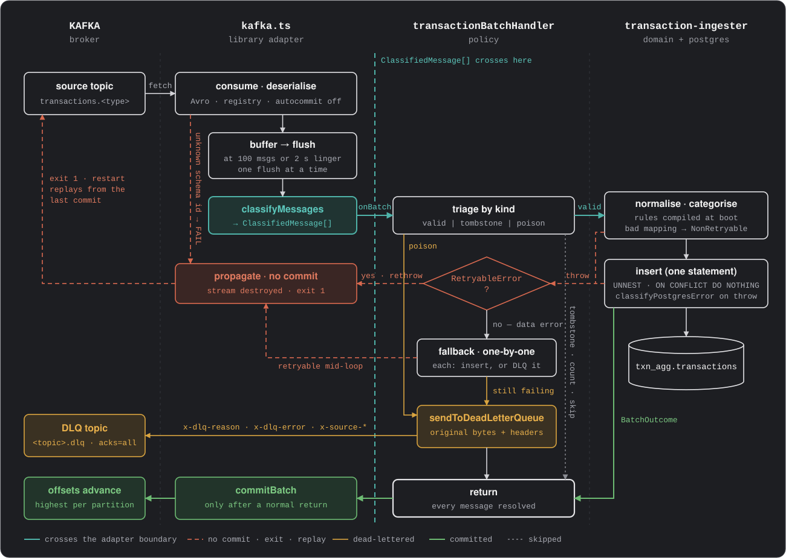

# Transaction Aggregator Consumer


This service reads transaction events from Kafka in batches, categorises each one against a rule set, and writes them to PostgreSQL. A record that can't be decoded or stored goes to a dead-letter topic. When the failure is an outage, the process exits before committing anything, and the restart reads the batch again.

It is one app in the [transaction-aggregator](../../README.md) monorepo. The same image runs five times, once per transaction type (`card`, `eft`, `loan`, `debit_order`, `internal_transfer`). Each instance has its own source topic, consumer group and dead-letter topic.

## How it works

- **Batches.** Messages are buffered and flushed as one batch once 100 have arrived (`KAFKA_BATCH_SIZE`) or 2 seconds after the first one arrived (`KAFKA_BATCH_LINGER_MS`), whichever happens first. Only one flush runs at a time.
- **One insert per batch.** Valid messages are normalised and categorised, then written by a single `INSERT … SELECT FROM unnest(…)` statement, which is atomic without a transaction.
- **Idempotent writes.** The insert uses `ON CONFLICT (transaction_type, external_id, occurred_at) DO NOTHING`. Kafka may deliver a message more than once, but each row is stored once, so replaying a batch is safe.
- **Commit last.** Offsets are committed by hand (`autocommit: false`), after the batch handler returns. The handler returns only once every message in the batch has been inserted, dead-lettered or skipped.
- **Exit instead of retrying.** A retryable failure (connection lost, deadlock, serialization failure) is rethrown and the process exits without committing. Docker restarts it (`restart: unless-stopped`), and the batch is read again from the last commit.
- **A bad row costs only itself.** If the batch insert fails because of the data, each message is inserted on its own, and any that still fail go to the dead-letter topic.

## Batch flow



`kafka.ts` owns the consume loop, the batching and the commits. Before handing a batch over, it turns it into `ClassifiedMessage[]` (`valid`, `tombstone` or `poison`). The handler and the services never see a Kafka message. Their unit tests need neither Kafka nor Postgres, and the [integration tests](#testing) run them against a real Postgres.

### What happens to each message

| Message or failure | Decided in | Outcome |
| --- | --- | --- |
| Decodes and maps cleanly | `classifyMessages` → `valid` | Inserted with the batch |
| Same row already stored | `ON CONFLICT DO NOTHING` | Skipped; counted in `duplicates_skipped_total` |
| Tombstone or empty payload | `classifyMessages` → `tombstone` | Skipped; counted in `tombstones_skipped_total` |
| Bytes that don't decode as Avro | `handleDeserialisationError` → `CONTINUE` → `poison` | Dead-lettered with `x-dlq-reason: deserialisation` |
| Schema id not loaded at startup | `handleDeserialisationError` → `FAIL` | Exits without committing; the restart loads the new schema and reads the message again |
| Record that doesn't map to a valid row | `normaliseTransaction` → `NonRetryableError` | Retried on its own, then dead-lettered with `x-dlq-reason: processing` |
| Row Postgres rejects (SQLSTATE class 22 or 23: a bad value or a constraint) | `classifyPostgresError` → `NonRetryableError` | Retried on its own, then dead-lettered with `x-dlq-reason: processing` |
| Any other Postgres failure (down, timed out, deadlock, read-only standby, bad password, missing grant) | `classifyPostgresError` → `RetryableError` | Exits without committing; the restart replays the batch |
| Dead-letter publish fails | `sendToDeadLetterQueue` throws | Exits without committing; the restart replays the batch |
| Offset commit fails after a good flush | `drainBatch` | Logged as a warning. The next commit on that partition covers these offsets. |

A dead-letter record carries the message exactly as it arrived: the original key, bytes and headers, so it can be produced to the source topic again unchanged, onto the same partition. The consumer adds these headers:
- `x-dlq-reason`: `deserialisation` or `processing`
- `x-dlq-error`
- `x-source-topic`, `x-source-partition`, `x-source-offset` and `x-source-timestamp` (when the original was produced, in epoch milliseconds)

The dead-letter producer waits for `acks=all`, so a record counts as sent only once every in-sync replica has it.

## Startup and shutdown

`app.ts` starts the service in this order. Steps 3 to 6 are startup checks. Each one logs how long it took, and one that fails logs the error and exits with code 1. Docker then restarts the container.

1. **Config**: `runtime.ts` parses the environment with Zod, which also checks the Kafka timeouts against each other. It then freezes the config and reads the secrets from files in `SECRET_DIR`. Bad config fails before anything connects.
2. **Tracing**: starts only when `OTEL_SDK_DISABLED=false`.
3. **PostgreSQL**: creates the pool and runs `SELECT 1`.
4. **Ruleset**: loads the active categorisation rules. The ingester compiles them once, so a batch only looks rules up.
5. **Schema registry**: loads every registered version of `<topic>-value`. Deserialisers are synchronous, so nothing is fetched while a message is being read.
6. **Kafka**: creates the consumer and the dead-letter producer, and fetches metadata with both to prove that the brokers are reachable and the SASL credentials work.
7. **HTTP server**: serves `/health`, `/info` and `/metrics` on `PORT`.
8. **Consume**: starts lag monitoring and the batch loop.

Shutdown runs on `SIGTERM` or `SIGINT`, or when the loop stops on an error. It closes things in this order:
1. The consumer. The close is forced, so it leaves the group immediately.
2. The Postgres pool.
3. The dead-letter producer.
4. The HTTP server.
5. Buffered traces are flushed.

A batch cut off by shutdown was never committed, so it is read again after the restart.

## Project structure

```text
apps/consumer
├── Dockerfile                     node:24-alpine; runs src/app.ts directly, no build step
├── package.json                   scripts, #src/* import alias, madge config
├── biome.json                     lint and format
├── cspell.json                    spelling
├── drizzle.config.ts              drizzle-kit pull from the live database
├── sample.env                     environment for npm start against the make up stack
├── test.env                       Docker socket for Testcontainers
├── docs/
│   └── batch-flow.svg             the diagram above
├── scripts/
│   ├── generate-avro-types.ts     schemas/*.avsc (repo root) → src/schemas/*.ts
│   └── cleanup-drizzle-pull.ts    tidies drizzle-kit pull output
├── test/
│   └── integration/
│       ├── transaction-insert.test.ts     the batch insert, column by column
│       ├── batch-ingestion.test.ts        a rejected row dead-lettered alone; the seeded loan rules
│       ├── database-outage.test.ts        an outage is retryable, never dead-lettered
│       └── helpers/                       test database, message and row builders, recording DLQ
└── src/
    ├── app.ts                     startup checks, wiring, consume loop, shutdown
    ├── runtime.ts                 config, secrets and package info, loaded once
    ├── config.ts                  environment → frozen config (Zod)
    ├── logger.ts                  pino; one child logger per file; card numbers redacted
    ├── errors/
    │   ├── consumer-errors.ts     RetryableError, NonRetryableError, UnknownSchemaIdError, SchemaRegistryError
    │   └── postgres.ts            SQLSTATE or socket error → retryable or not
    ├── integrations/
    │   ├── events/
    │   │   ├── kafka.ts                   consumer, dead-letter producer, batching, classifyMessages
    │   │   ├── commit.ts                  commits the highest offset per partition
    │   │   ├── avro-deserialiser.ts       Confluent wire format → value + original bytes
    │   │   ├── schema-registry.ts         registry client, used at startup
    │   │   └── handlers/
    │   │       ├── transactionBatchHandler.ts      batch policy: insert, fallback, dead-letter
    │   │       └── handleDeserialisationError.ts   FAIL on an unknown schema id, otherwise CONTINUE
    │   ├── database/
    │   │   ├── pool.ts                    pg Pool, Drizzle for the ruleset
    │   │   ├── repositories/              transaction insert (unnest), ruleset load (Drizzle)
    │   │   └── schemas/                   Drizzle tables, pulled from the database
    │   └── http/
    │       └── server.ts                  /health, /info, /metrics
    ├── domain/                    pure: no I/O, no async; imports only schemas/ and errors/
    │   ├── transaction-normaliser.ts      each source shape → one canonical row
    │   └── rule-categoriser.ts            compiled rules: five matcher tiers, then a fallback
    ├── services/                  the use case that does the I/O; knows nothing about Kafka
    │   └── transaction-ingester.ts        normalise → categorise → insert
    ├── schemas/                   Zod: five generated source schemas and the canonical row
    ├── telemetry/
    │   ├── metrics.ts                     Prometheus registry and the consumer's own metrics
    │   └── tracing.ts                     OpenTelemetry; off unless enabled
    └── utils/
        └── secrets.ts                     reads each secret from a file in SECRET_DIR
```

Each unit test (`src/**/*.test.ts`) sits next to the file it tests; the tree leaves them out.

## Observability

| Endpoint | Returns |
| --- | --- |
| `GET /health`, `GET /healthz` | `{"status":"ok"}`, for liveness |
| `GET /info` | app, Node version, host, PID, uptime |
| `GET /metrics` | Prometheus text format |

The consumer's own metrics measure the work the Kafka client can't see:

| Metric | Type | What it measures |
| --- | --- | --- |
| `batch_size` | histogram | Messages per flush |
| `batch_flush_total{trigger}` | counter | Flushes by trigger: `size`, `linger` or `stream_end` |
| `batch_flush_duration_seconds` | histogram | The whole flush: handling the batch, then committing it |
| `insert_duration_seconds` | histogram | The batch INSERT only |
| `rows_inserted_total` | counter | Rows actually inserted |
| `duplicates_skipped_total` | counter | Rows skipped by `ON CONFLICT DO NOTHING` |
| `dlq_messages_total{reason}` | counter | Dead-lettered messages, by `deserialisation` or `processing` |
| `tombstones_skipped_total` | counter | Tombstones skipped |
| `categorization_verdicts_total{matcher_type}` | counter | Which matcher tier decided each stored row's category |
| `ingest_lag_seconds` | histogram | Insert time minus the Kafka record timestamp |

The same registry also exports two other sets of metrics:
- the client's own metrics (`kafka_consumed_messages`, `kafka_consumers_lags`, …), refreshed every `KAFKA_LAG_MONITORING_INTERVAL_MS`
- Node's default process metrics

Tracing is off unless `OTEL_SDK_DISABLED=false`. When it is on, each batch is its own trace:
- **`consume.batch <topic>`**: the root span. It links to each producer's trace through the message's `traceparent` header.
- **`categorize`** and **`db.insert`**: child spans for the two ingest steps.
- **`dlq.publish`**: a span for each dead-letter send.

## Configuration

All configuration comes from environment variables, validated at startup by [`src/config.ts`](src/config.ts). Passwords are never in the environment: `DATABASE_PASSWORD_SECRET_NAME` and `KAFKA_PASSWORD_SECRET_NAME` name files in `SECRET_DIR`. The variables that change behaviour:

| Variable | Default | Effect |
| --- | --- | --- |
| `TRANSACTION_TYPE` | `card` | Picks the normaliser and the consumer group (`transaction-consumer-<type>`) |
| `KAFKA_TOPIC` | required | Source topic; the dead-letter topic is `<KAFKA_TOPIC>.dlq` |
| `KAFKA_BROKERS` | required | Comma-separated broker list |
| `KAFKA_BATCH_SIZE` | `100` | Flush once this many messages are buffered |
| `KAFKA_BATCH_LINGER_MS` | `2000` | …or this long after the first one arrives |
| `KAFKA_MAX_WAIT_TIME_MS` | `1000` | Longest a fetch waits at the broker |
| `KAFKA_FETCH_MAX_BYTES` | `1048576` | The most one fetch returns. The client holds a whole fetch in memory, so this bounds memory when the consumer is far behind |
| `KAFKA_READ_MODE` | `committed` | Resume from the group's committed offsets, or from `earliest` if it has none |
| `KAFKA_SESSION_TIMEOUT_MS` | `15000` | Group membership; the four timeouts are checked against each other |
| `KAFKA_HEARTBEAT_INTERVAL_MS` | `5000` | At most a third of the session timeout |
| `KAFKA_REBALANCE_TIMEOUT_MS` | `30000` | At least the session timeout |
| `KAFKA_REQUEST_TIMEOUT_MS` | `40000` | Must exceed the rebalance timeout |
| `DATABASE_POOL_MIN` / `DATABASE_POOL_MAX` | `3` / `20` | Postgres pool size |
| `DATABASE_SSL` | `false` | Connect to Postgres over TLS |
| `SCHEMA_REGISTRY_URL` | `http://localhost:8081` | Read once at startup |
| `OTEL_SDK_DISABLED` | `true` | Set to `false` to export traces over OTLP |
| `HOST` / `PORT` | `0.0.0.0` / `6000` | Address and port the HTTP server listens on |

## Running it

The whole system, including all five consumers, runs from the repo root:

```sh
make up     # Kafka, Schema Registry, Postgres, producers and consumers
make logs
```

To run one consumer from the host against that stack:

```sh
cp sample.env .env    # already points at the make up stack; secrets go in ./secrets
npm install
npm start
```

Node 24 strips the TypeScript types itself, so nothing is built and the Docker image runs `src/app.ts` as it is.

| Script | What it does |
| --- | --- |
| `npm start` | Runs the consumer with `.env`, pretty-printing the logs |
| `npm run test:unit` | Unit tests (`node:test`) |
| `npm run test:integration` | Integration tests against Postgres in a container (needs Docker) |
| `npm run fms` | Biome lint and format, spelling, import-cycle check (madge), type check |
| `npm run check` | Import-cycle check, then `tsc` |
| `npm run schema:generate` | Regenerates `src/schemas/*.ts` from the repo's Avro schemas |
| `npm run drizzle:pull-schema` | Regenerates the Drizzle tables from the live database |
| `npm run lib:audit` | Dependency audit (`audit-ci`) |
| `npm run lib:update` | Interactive dependency upgrades |

## Testing

**Unit tests** (`npm run test:unit`) sit next to the code they test. Postgres and the dead-letter sender are replaced by fakes, so nothing needs to be running.

**Integration tests** (`npm run test:integration`) run the consumer's write path against a real PostgreSQL 18, started by Testcontainers. Each test file gets a fresh database, built the way compose builds it:
- the repo's Postgres image (`infrastructure/postgres`), started with compose's `postgres` command
- the `initdb` scripts, which create the logins
- every migration in `database/migrations`, applied as `admin`

The code under test connects as `kafka_consumer`, the consumer's own login, so a missing grant fails the test just as it would in production. The tests read results back as `admin`. Kafka isn't started: the dead-letter sender is replaced by one that records what it's given.

| Test file | What it checks |
| --- | --- |
| `transaction-insert.test.ts` | Every field lands in its own column, including a bigint past the 32-bit range, escaped JSON and nulls. A re-sent batch inserts only the new rows and reports how many it inserted. A transaction older than every monthly partition is stored in the default partition. |
| `batch-ingestion.test.ts` | A row Postgres rejects (the `amount_minor > 0` check) is dead-lettered alone with its original bytes, and the rest of the batch is stored. |
| `database-outage.test.ts` | If the database dies during an insert, or is already down when a batch arrives, the flush fails with `RetryableError` and nothing is dead-lettered. |

The integration tests need Docker. The first run builds the Postgres image, which takes a while; after that, Docker's build cache makes a run take a few seconds. The API's integration tests build the same image under the same name, so either suite fills the cache. The tests use the dev secrets in the repo's root `secrets/` folder.

`test.env` points Testcontainers at Rancher Desktop's Docker socket. With any other Docker setup, edit or empty it, but keep the file: `node --env-file` fails if it's missing.

## Rules

1. No circular dependencies.
2. Fail fast on invalid config.
3. One config object, frozen.
4. Create shared instances once and pass them in; modules never create their own.
5. One database pool, for the write instance.
6. Keep business logic in its own layer, apart from the wiring.
7. Emit metrics and structured logs.
8. Shut down gracefully: close the Kafka clients and the pool.
9. Put a timeout on every external call.
10. Keep retries easy to manage.
11. Make writes idempotent.
12. Handle errors efficiently and document them.
13. Keep unit tests next to the code they test.
14. Validate data at every boundary.
15. Never create infrastructure: no topics, no tables.
